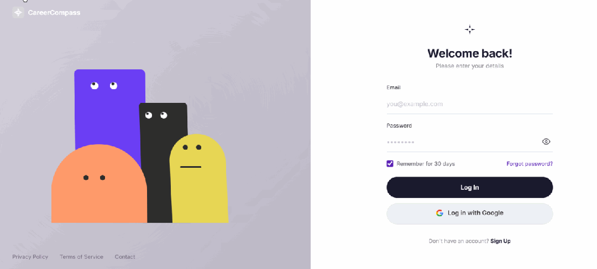

# Implementing a Super-Cool Login Interface with HTML and Django

Using HTML and Django to implement two identical ultra-cool login interfaces, the effect is as follows: a login page with an interactive animated character.

Using HTML and Django to implement two identical ultra-cool login interfaces.



A login page with interactive animated characters. The characters will follow the mouse movements and respond to user inputs, providing a lively and interesting login experience.

#### Preview

##### Page layout

- **Left panel**

4 Animation characters (purple rectangle, black rectangle, orange semi-circle, yellow rounded rectangle)

- **Right panel**

Login form (Email, Password, Login button, Google login)

##### Interactive Animation Effects

|

Scene

 ||

Effect

 |
|

Free

 ||

The character's eyes follow the mouse movement, and its body slightly tilts.

 |
|

Random blinking

 ||

Random blinking intervals between purple and black characters

 |
|

Enter your email address

 ||

Roles looking at each other

 |
|

Enter password

 ||

Role turns away and does not look at the password.

 |
|

Display password

 ||

The character looks towards the distance, and the purple character occasionally peeks over.

 |
|

Login Failed

 ||

The character displays a dejected expression and shakes its head.

 |
|

Button hover

 ||

Text slides out, purple background + arrow slides in

 |

#### Technical Implementation

Single HTML file, zero dependencies:

- **Layout**

CSS Grid Two-Column Layout, Responsive Compatibility

- **Role**

- Pure CSS graphics (Rounded Rectangles, Half-Circles)

- **Animation**

CSS transitions + keyframes + native JavaScript state management

- **Interaction**

Mouse follow (mousemove), focus detection (focus/blur), form validation

#### Usage

Open `index.html` directly in the browser.

```
open index.html
```

#### File Structure

```
login/
index.html # Complete page (HTML + CSS + JS)
PRD.md  # Product Requirements Document
README.md
```

The entire project file code only contains index.html, source code address:

I have also implemented a login interface with the same functionality using Python and Django, source code address:


## Payment

Here is a pay link on Stripe ( https://buy.stripe.com/3cs8yP7sY87d0vu9AB ). Please contact me lonlonago@foxmail.com after funding $89, and I will send you a complete data files , thank you!


